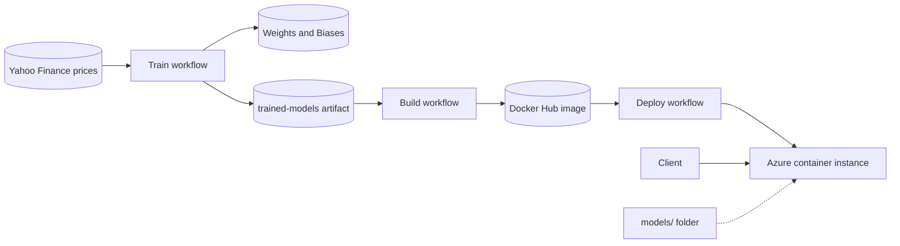
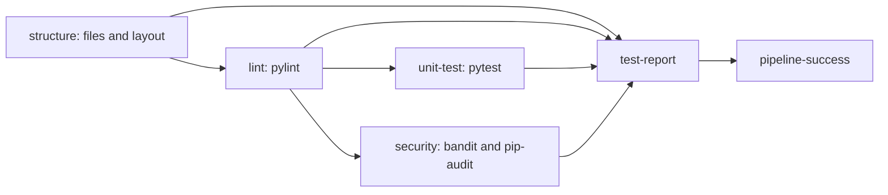
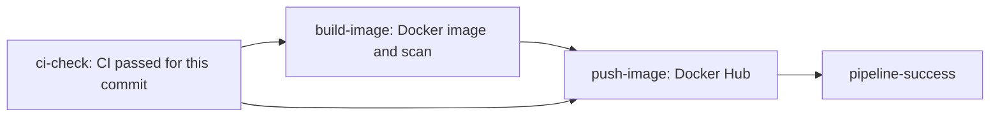
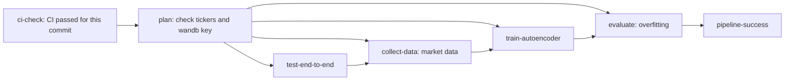
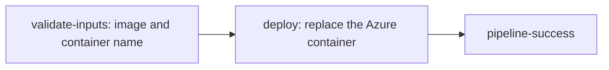
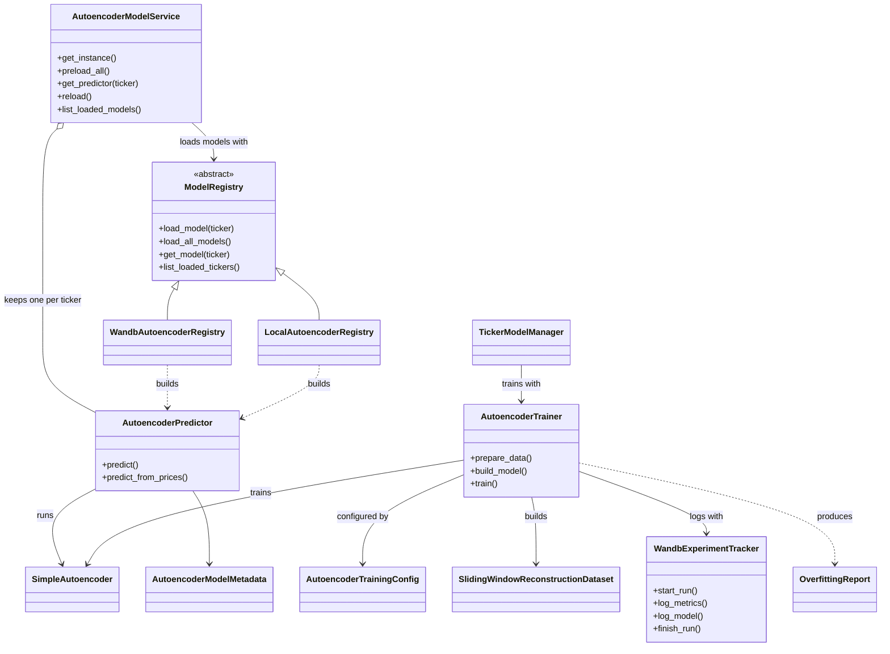
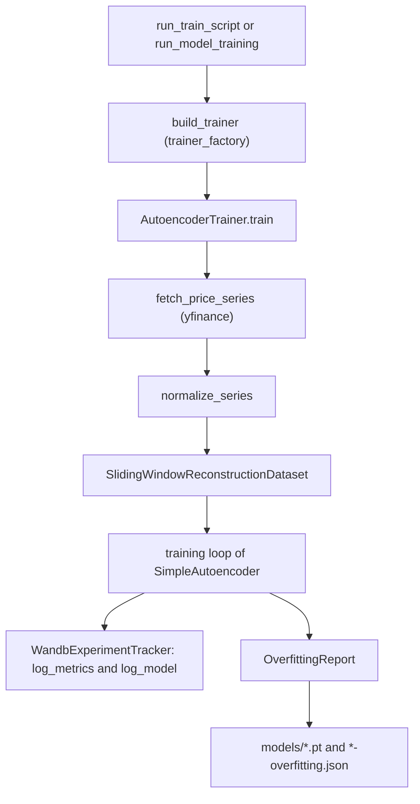
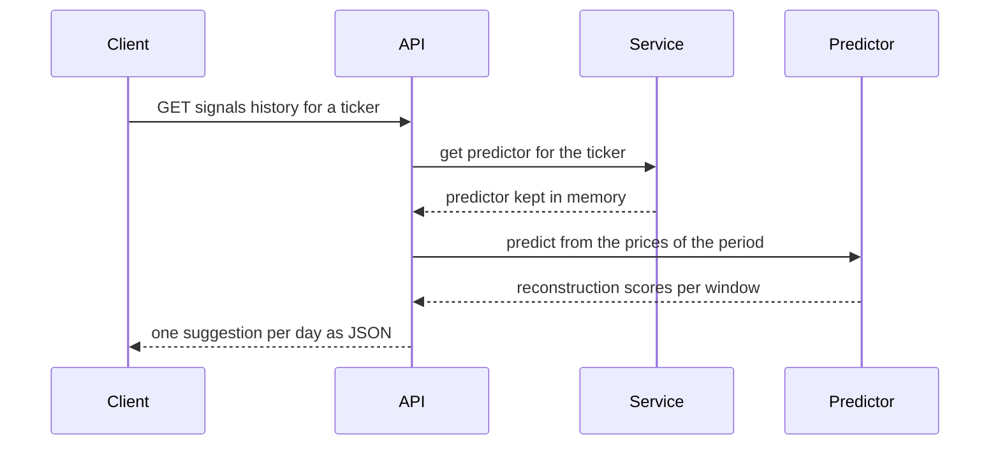

# Financial Market Simulator

Financial Market Simulator is a research and teaching project that uses
autoencoders to detect outliers in financial price time series. For each
ticker, an autoencoder is trained on the daily log-returns of its closing
prices. It learns to reconstruct the normal behavior of the market. A window
of returns that the model reconstructs badly is flagged as an outlier, which
means the market moved in an unusual way.

## What the project does

- **Data:** downloads the daily closing prices of a ticker (for example
  `AAPL` or `PETR4.SA`) from yfinance, validates them with quality checks
  (Great Expectations), and computes the daily log-returns.
- **Split:** divides the log-returns in time order into train (70%),
  validation (15%) and a held-out test set (15%). The test set is evaluated
  only once, after training.
- **Model:** a dense autoencoder trained on sliding windows of returns. The
  reconstruction error of a window is its anomaly score. The anomaly threshold
  is stored with the model.
- **Evaluation:** the model must beat a naive baseline on the test set, and
  its validation error must not be much larger than its training error, which
  would indicate overfitting.
- **Serving:** a FastAPI service that loads the trained models and returns, for
  each window of a series, its score and whether it is an outlier. Each
  request is routed to the model of its ticker.
- **Delivery:** GitHub Actions workflows test the code, train the models,
  build a Docker image with the trained models and push it to Docker Hub.

## Scope and limits

This is a teaching and research project. The models describe unusual
behavior in past prices; they do not predict prices, and they are not
investment advice. Results depend on the period and the ticker used, and
they have not been validated for trading.

The project is used in a course, so it favors clear code, documented specs
and reproducible workflows over performance.

## Diagrams

The diagrams below are written in [Mermaid](https://mermaid.js.org/), which
GitHub renders directly in this file. They follow the code of the `main`
branch.

### How the project fits together



### CI pipeline (`ci.yml`)

Runs on every push and pull request. Each job waits for the jobs it needs.



### Build pipeline (`build.yml`)

Started by hand. It only runs after the CI passed for the same commit.



### Train pipeline (`train.yml`)

Started by hand. It trains the models, evaluates the overfitting and stores
the trained models as an artifact.



### Deploy pipeline (`deploy.yml`)

Started by hand. It replaces the Azure container instance so that it runs an
image from Docker Hub.



### Classes of the main package

Main classes of `src/generative_models` and how they depend on each other.
Only the public methods are shown.



### Training flow

What happens when a model is trained from the command line.



### Prediction flow

When a client asks for the signal history of a ticker, the request goes through the API, the model service and the predictor. The
models are loaded once, when the API starts (`preload_all`). A request
then uses the predictor kept in memory for its ticker.




## Project structure

```
financial_market_simulator/
├── README.md
├── pyproject.toml                 # dependencies and tool settings
├── requirements.txt               # full development environment
├── uv.lock                        # versions locked by uv
├── Dockerfile                     # image that serves the FastAPI autoencoder API
├── .dockerignore
├── .trivyignore                   # vulnerabilities accepted in the image scan
├── .env.example                   # template of the variables; copy it to .env
├── .gitignore
├── CLAUDE.md
├── .github/
│   ├── copilot-instructions.md
│   ├── actions/
│   │   └── setup-python-uv/       # composite action: Python 3.12 and uv
│   └── workflows/                 # ci.yml, train.yml, build.yml, deploy.yml
│
├── docs/                          # explanatory documents of the project
├── load_test/                     # Locust load test of the API (own uv project)
├── models/                        # trained models copied into the image
├── notebooks/                     # exploratory and teaching notebooks
├── specs/                         # module specs for students
│   ├── project_structure_check/   # layout, contracts and quality gates
│   ├── training/                  # training pipeline specs
│   └── serving/                   # inference and REST API specs
│
├── src/
│   └── generative_models/
│       ├── data/                  # market data, validation, normalization, datasets
│       ├── models/
│       │   ├── base_autoencoder/  # reference model: autoencoder, trainer, overfitting
│       │   ├── regression/        # feed-forward regression model
│       │   ├── autoencoder/       # placeholder package
│       │   ├── convolutional_autoencoder/  # placeholder package
│       │   ├── gru_autoencoder/   # placeholder package
│       │   └── lstm_autoencoder/  # placeholder package
│       ├── registry/              # model registry
│       ├── serving/               # FastAPI API, model service, predictor, signals
│       └── tracking/              # experiment tracking (Weights & Biases)
│
└── tests/                         # unit and end-to-end tests, mirroring src/
```

## Tech stack

- **Python** 3.12
- **PyTorch** for model definition and training
- **NumPy** / **Pandas** for data manipulation
- **yfinance** for market data retrieval
- **Weights & Biases (wandb)** for experiment tracking
- **FastAPI** / **uvicorn** for model serving
- **Jupyter** for notebooks
- **pytest** for unit testing
- **uv** as the package and environment manager

## Getting started

This guide starts from a machine without anything installed except Git. The
project uses [uv](https://docs.astral.sh/uv/) to manage Python and the
dependencies: uv installs the Python version and the packages from
`pyproject.toml` and `uv.lock`, the same way the CI does.

### 1. Install uv

On Windows (PowerShell):

```powershell
powershell -ExecutionPolicy ByPass -c "irm https://astral.sh/uv/install.ps1 | iex"
```

On macOS or Linux:

```bash
curl -LsSf https://astral.sh/uv/install.sh | sh
```

Close and open the terminal, then check it:

```bash
uv --version
```

You do not need to install Python yourself: uv downloads the Python version
the project uses (below).

### 2. Get the code

```bash
git clone https://github.com/IBMEC-CDIA/financial_market_simulator.git
cd financial_market_simulator
```

### 3. Install Python and the dependencies

Install the Python version used by the project and create the virtual
environment with every dependency needed for tests, linting and the API:

```bash
uv python install 3.12.10
uv sync --extra dev --python 3.12.10
```

This creates the `.venv` folder inside the project. You do not need to
activate it: run commands with `uv run`, as shown below.

On Windows, `uv sync` installs PyTorch with CUDA support (the
`pytorch-cu121` index in `pyproject.toml`). On macOS and Linux it installs
the default PyTorch build.

### 4. Configure the environment variables

```bash
cp .env.example .env
```

Open `.env` and set `WANDB_API_KEY` with your Weights & Biases key. The key
is needed to train models and to download them from wandb. The tests and the
API with local model files do not need it. Never commit `.env`.

### 5. Check the installation

Run the tests and the linter, the same checks the CI runs:

```bash
uv run pytest
uv run pylint src/generative_models tests
```

### 6. Run the API locally

The API serves the model files in `models/`. Each model is a `.pt` file with
its `*-overfitting.json` report. Get them from a successful Train run (see
the Serving section), or from the wandb artifacts of the project, and copy
them into `models/`. Then start the API:

```bash
uv run uvicorn generative_models.serving.api:app --port 8000
```

Open `http://127.0.0.1:8000/docs` for the interactive API docs, or
`http://127.0.0.1:8000/health` to check that the models were loaded.

### 7. Run the notebooks (optional)

The notebooks in `notebooks/` use four packages that are not part of
`pyproject.toml` yet: `pgl-utils`, `torchinfo`, `plotly` and `jupyter`.
Install them into the project environment, then start Jupyter:

```bash
uv pip install pgl-utils torchinfo plotly jupyter
uv run jupyter lab
```

### About `requirements.txt`

`requirements.txt` is not used by the CI and does not describe the complete
environment. It does not include `python-dotenv` (used at runtime to read
`.env`), `pytest`, `pylint`, `great-expectations` or `httpx` (used by the
tests), and it pins a PyTorch build (`2.5.1+cu121`) that is only published
for Windows and Linux. Use the steps above (`uv sync`) instead of
`pip install -r requirements.txt`.

### Specs for students

The autoencoder training pipeline and its serving layer are **not**
part of this branch: students build them from the notebook
`draft/autoencoder_outlier_gab_draft.ipynb`, following the specs in
the [`specs/`](specs/README.md) folder (written in Portuguese). Each
spec describes the public interface, the expected behavior and
errors, and numbered acceptance criteria that must be turned into
unit tests. The specs are split into two tracks:

- [`specs/training/`](specs/training/README.md): `SimpleAutoencoder`,
  training configuration, `AutoencoderTrainer` and a training CLI;
- [`specs/serving/`](specs/serving/README.md): predictor, wandb
  model registry, prediction CLI, model service singleton and a
  FastAPI application.

The base modules the notebook already imports
(`data/market_data.py`, `data/datasets.py`, `data/normalization.py`
and `tracking/wandb_tracker.py`), as well as the `ModelRegistry`
interface (`registry/model_registry.py`), are provided and documented
by their own specs as reference. Start from
[`specs/README.md`](specs/README.md), which explains the workflow and
the order of the tracks.

Once both tracks are implemented, the project can be used with:

```bash
uv run python -m generative_models.serving.predict_autoencoder
uv run uvicorn generative_models.serving.api:app --reload
```

### Example: training an autoencoder from the command line

The training script trains the autoencoder of one ticker, logs the run
to wandb and saves the weights in the output directory. Only `--ticker`
is required; every other option defaults to the values of the
configuration dataclasses in
`src/generative_models/models/base_autoencoder/config.py`.

Quick run with a short history and two epochs (PowerShell):

```powershell
uv run python -m generative_models.models.base_autoencoder.run_train_script `
    --ticker AAPL `
    --start-date 2024-01-01 `
    --end-date 2024-12-31 `
    --window-size 10 `
    --batch-size 16 `
    --epochs 2 `
    --device cpu
```

The same run in bash:

```bash
uv run python -m generative_models.models.base_autoencoder.run_train_script \
    --ticker AAPL \
    --start-date 2024-01-01 \
    --end-date 2024-12-31 \
    --window-size 10 \
    --batch-size 16 \
    --epochs 2 \
    --device cpu
```

A complete run with the default settings (300 epochs, window of 10
log-returns) and the wandb project and output directory set explicitly:

```bash
uv run python -m generative_models.models.base_autoencoder.run_train_script \
    --ticker PETR4.SA \
    --start-date 2020-01-01 \
    --end-date 2026-09-15 \
    --epochs 300 \
    --learning-rate 0.001 \
    --random-seed 42 \
    --contamination 0.05 \
    --project-name autoencoder-simple-outlier-trading-agent \
    --output-directory artifacts \
    --env-file-path .env
```

Options:

| Option | Default | Meaning |
|---|---|---|
| `--ticker` | required | Ticker symbol, for example `AAPL` or `PETR4.SA`. |
| `--start-date`, `--end-date` | `2020-01-01`, `2026-09-15` | Historical range (`YYYY-MM-DD`). |
| `--train-split-ratio` | `0.7` | Fraction of the log-returns used for training, in time order. |
| `--window-size` | `10` | Number of log-returns in each window. |
| `--batch-size` | `32` | Windows per training batch. |
| `--hidden-layer-size`, `--latent-layer-size` | `16`, `4` | Sizes of the autoencoder layers. |
| `--epochs` | `300` | Number of training epochs. |
| `--learning-rate` | `0.001` | Learning rate of the Adam optimizer. |
| `--random-seed` | `42` | Seed for weight initialization and batch shuffling. |
| `--contamination` | `0.05` | Expected fraction of anomalous windows; it sets the anomaly threshold. |
| `--project-name` | `autoencoder-simple-outlier-trading-agent` | wandb project name. |
| `--output-directory` | `artifacts` | Directory where the `.pt` weights are saved. |
| `--env-file-path` | `.env` | `.env` file with `WANDB_API_KEY`. |
| `--device` | automatic | `cpu` or `cuda`. |

The script prints a summary line when it finishes, for example:

```text
ticker=AAPL final_train_loss=1.039433 validation_loss=0.469093 anomaly_threshold=2.228271 model_file_path=artifacts\simple-autoencoder-aapl.pt
```

The weights are saved as `<output-directory>/simple-autoencoder-<ticker>.pt`
(the ticker is lowercased, and characters other than letters, digits,
`.`, `_` and `-` become `-`). The wandb login uses `WANDB_API_KEY` from
the `.env` file. Without a key, the run logs in anonymously. If the
login fails (for example, without internet access), the run falls back
to disabled tracking, and training still completes.

Run `--help` to see the same options from the terminal:

```bash
uv run python -m generative_models.models.base_autoencoder.run_train_script --help
```

## Serving the API

The image serves the trained autoencoders through the FastAPI application
in `generative_models.serving.api`, on port `8000`. The models are part of
the image: the build downloads the `trained-models` artifact of a successful
Train run into `models/`, and the API loads every model of that folder when
it starts. A prediction is routed to the model of the ticker in the request,
and an unknown ticker gets a `404`. The container does not need the wandb key.

To run the image locally, put the files of a trained model in `models/`
(the `*-overfitting.json` report and the `.pt` weights), then:

```bash
docker build -t financial-market-simulator .
docker run --rm -p 8000:8000 financial-market-simulator
```

Then open `http://127.0.0.1:8000/docs` for the interactive API docs, or
`http://127.0.0.1:8000/health` to check the service. The image sets
`AUTOENCODER_MODEL_DIR=/app/models`. The container accepts these optional
variables:

- `AUTOENCODER_MODEL_DIR`: folder with the model files. When it is set, the
  models are read from this folder and wandb is not used.
- `AUTOENCODER_WANDB_PROJECT` and `AUTOENCODER_WANDB_ENTITY`: used only when
  `AUTOENCODER_MODEL_DIR` is not set.
- `AUTOENCODER_DEVICE`: `cpu` or `cuda`. Defaults to `cuda` when available.
- `AUTOENCODER_PRELOAD_MODEL`: `false` to skip loading the models at startup.

## Continuous integration

Four workflows in `.github/workflows/` run the project:

| Workflow | File | How it starts | Purpose |
|---|---|---|---|
| CI | `ci.yml` | Every push and pull request, or by hand | Checks the project, runs the tests and the security scans. |
| Train | `train.yml` | By hand | Trains the models of the given tickers and evaluates them. |
| Build | `build.yml` | By hand | Builds and tests the Docker image, then pushes it to Docker Hub. |
| Deploy | `deploy.yml` | By hand | Replaces the Azure container instance with an image from Docker Hub. |

The CI workflow has these jobs:

- `structure` checks the required files, that `.env` is ignored by git and
  Docker and never tracked, and the layout of the model packages.
- `lint` runs pylint on `src/generative_models` and `tests`.
- `unit-test` runs pytest with coverage. It fails when the coverage of
  `src/generative_models` is below 60%, and uploads the JUnit and coverage
  reports as the `unit-test-reports` artifact.
- `security` audits the runtime dependencies locked in `uv.lock` with
  `pip-audit`, scans the source code with Bandit at medium severity and
  above, and scans the git history for committed secrets with Gitleaks.
- `test-report` writes the test results and the coverage to the job summary.
- `pipeline-success` fails when any job before it did not succeed.

Changes that only touch Markdown files, `specs/` or `docs/` do not start CI.
The shared setup (Python, uv, cache and dependencies) lives in the composite
action `.github/actions/setup-python-uv`.

To run the end-to-end tests locally, which simulate the prices and need
neither network access nor a wandb key:

```bash
uv run pytest tests/end_to_end
```

### Training workflow (`train.yml`)

The training workflow is started by hand from the Actions tab (Run workflow),
or from the command line with
`gh workflow run train.yml -f tickers=AAPL,MSFT`. The W&B key is not an input:
the workflow always uses the `WANDB_API_KEY` repository secret. Its inputs are:

- `model`: the model package to train, for example `base_autoencoder`
  (default). The `plan` job checks that the package has `trainer_factory.py`
  and `overfitting.py`, so a placeholder package is refused.
- `tickers`: comma-separated ticker symbols, for example `AAPL,MSFT,PETR4.SA`.
  The jobs run once per ticker.
- `experiment`: the name the models are registered under in wandb, for example
  `aapl-baseline` (default `default`). The build picks the models of an
  experiment by this name, so runs with different settings do not get mixed.
  Use lowercase letters, digits and hyphens, at most 40 characters, not
  `latest`.
- `epochs`, `learning_rate` and `window_size`: training hyperparameters.

It runs these jobs in order:

1. `ci-check` stops the run unless the CI workflow passed for the same commit.
2. `plan` checks the ticker symbols and the `WANDB_API_KEY` secret, and turns the list into
   the matrix of the next jobs.
3. `test-end-to-end` runs the end-to-end tests.
4. `collect-data` downloads and validates the prices of each ticker, then
   uploads them.
5. `train-autoencoder` runs `models/run_model_training` for the chosen model. It
   trains the models of all the tickers with the `TickerModelManager`, in
   sequence, and uploads the weights and the overfitting reports as the
   `trained-models` artifact. The key is masked in the logs.
6. `evaluate` checks the overfitting ratio and the baseline comparison of every
   report in that artifact.
7. `pipeline-success` fails unless every job above succeeded.

### Build workflow (`build.yml`)

The build workflow is also started by hand, with Run workflow. It waits for the
CI run of the same commit to finish, fails unless that run passed, then
downloads the trained models, builds the
Docker image, smoke tests it and scans it with Trivy.

To build without a Train run, leave `train_run_id` empty and fill in `tickers`
(for example `PETR4.SA,AAPL`) and `experiment` (for example `aapl-baseline`).
The job then runs `generative_models.serving.download_latest_models` with
`--alias <experiment>`, which writes the model of each ticker registered under
that experiment from wandb into `models/` before the image is built. A ticker
without a model under that experiment fails the job before the build starts.
The `latest` alias is not accepted as an experiment. The
report written this way has `test_loss` and `baseline_test_loss` set to `null`,
because the wandb artifact does not store them. It fails on fixable
`CRITICAL` or `HIGH` vulnerabilities. Then the `push-image` job logs in to
Docker Hub and pushes the image with three tags: the tickers tag, the commit
SHA and `latest`.

The image name is built from the models that the API reads. The build reads the
ticker of every `*-overfitting.json` in `models/`, lowercases them, sorts them
and joins them with `-`. For models of `AAPL` and `MSFT` the image is
`financial-market-simulator:aapl-msft`. The tag is limited to 120 characters.

The Docker Hub account and token are taken from the `dockerhub_username` and
`dockerhub_token` inputs of the dispatch. Leave them empty to use the
`DOCKERHUB_USERNAME` and `DOCKERHUB_TOKEN` secrets. For example:
`gh workflow run build.yml -f dockerhub_username=... -f dockerhub_token=...`.

Both `train.yml` and `build.yml` end with a `pipeline-success` job. It fails
unless every job before it succeeded.

### Deploy workflow (`deploy.yml`)

The deploy workflow is started by hand, with Run workflow. It replaces an Azure
container instance so that it runs an image from Docker Hub. The only input is
`image`, for example `myuser/financial-market-simulator:aapl-msft`, as the Build
workflow pushes it.

The container name and the DNS label are derived from the tag. The tag
`aapl-msft` gives the container `fmsim-aapl-msft`, and a dot becomes a hyphen,
so `petr4.sa` gives `fmsim-petr4-sa`. The name must be at most 63 characters.
The DNS label must be unique in the Azure region, so two images with the same
tag cannot run at the same time under different names.

The configuration comes from repository variables and secrets:

| Name | Kind | Required | What it is |
|---|---|---|---|
| `AZURE_RESOURCE_GROUP` | variable | yes | Resource group of the container instance. |
| `AZURE_LOCATION` | variable | no | Azure region. Defaults to `brazilsouth`. |
| `DEPLOY_ENVIRONMENT` | variable | no | GitHub environment of the deploy job. Defaults to `production`. |
| `AZURE_CREDENTIALS` | secret | yes | JSON of an Azure service principal, used by `azure/login`. |
| `DOCKERHUB_USERNAME` | secret | yes | Docker Hub account name, used by the container to pull the image. |
| `DOCKERHUB_TOKEN` | secret | yes | Docker Hub access token, used by the container to pull the image. |

Create the variables in Settings, Secrets and variables, Actions, Variables, or
with the GitHub CLI:

```bash
gh variable set AZURE_RESOURCE_GROUP --body "<resource-group>" --repo IBMEC-CDIA/financial_market_simulator
```

The job runs in the environment named by `DEPLOY_ENVIRONMENT` and stays running
until the deploy finishes. It waits up to 20 minutes for the instance to be
`Running`, then up to 20 minutes for `/health` to answer and `/models/loaded` to
list at least one model. The deploy has no rollback: if the creation fails after
the old instance was deleted, the service stays down until the workflow runs
again.

The service principal needs the `Contributor` role on the resource group. Create
it with:

```bash
az ad sp create-for-rbac   --name financial-market-simulator-deploy   --role Contributor   --scopes /subscriptions/<subscription-id>/resourceGroups/<resource-group>   --json-auth
```

Save the JSON printed by the command as the `AZURE_CREDENTIALS` secret.

### Signals endpoint (`GET /signals`)

`GET /signals?ticker=PETR4.SA` returns a list with the trading suggestion of
one asset, when its model has a signal. The `ticker` parameter is required.
The optional `start_date` and `end_date` parameters (`YYYY-MM-DD`) set the
period, and default to the last 365 days, as in the market data route. The
list is empty when the period has too few prices or when no rule is set. An
unknown ticker answers `404`. Each item has these fields:

- `symbol`: ticker in upper case, for example `"AAPL"`.
- `action`: `"buy"`, `"sell"` or `"hold"`.
- `confidence`: a number between 0 and 1.
- `generated_at`: the generation time in ISO 8601, in UTC.
- `model`: the model name, up to 60 characters, or `null`.
- `reason`: a plain explanation based only on the model numbers, up to 280
  characters, or `null`.

The default rule, `default_signal_rule` in `generative_models.serving.signals`,
looks at the most recent window. A window within the anomaly threshold gives
`hold`. An abnormal window gives `buy` after a price drop, `sell` after a price
rise, and `hold` when the price did not move. This rule is a proposal that the
team still has to confirm. Setting `signal_rules.default_signal_rule` to `None`
turns the answer into `[]`. These suggestions are not investment advice.

The output format is fixed by
[`specs/serving/08-signals-contract.md`](specs/serving/08-signals-contract.md).

### Signal history endpoint (`GET /signals/history`)

`GET /signals/history?ticker=AAPL&start_date=…&end_date=…` returns one
suggestion for each day of the period that the rule can decide. Each day is
decided with the windows known until that day, so the history is what the
model would have said on each day. The fields are the same as in `/signals`,
with `generated_at` set to the day of the window. Holds are included. The
period defaults to the last 365 days, as in `/signals`.

### Load test (`load_test/`)

`load_test/` has a Locust test that sends requests to the models the API
loads, with three load profiles: `spike` (peak), `ramp` (linear increase) and
`step` (progressive increase). Run `bash load_test/run_profiles.sh` with the
API running on port 8001, or see [load_test/README.md](load_test/README.md)
for the variables and the Locust web interface.

### Ticker model manager

`TickerModelManager` (`models/ticker_model_manager.py`) trains the model of
several tickers in sequence. For each ticker it downloads and validates the
prices, creates the trainer with the `trainer_factory` function and runs it.
Each model package provides its `build_trainer` function in
`trainer_factory.py`, which is the default factory when none is given. The
contract is described in
[`specs/project_structure_check/06-model-trainer-contract.md`](specs/project_structure_check/06-model-trainer-contract.md).

## Contributing guidelines

Coding conventions for this repository (docstring style, type hints,
notebook formatting, testing and documentation requirements) are
documented in [`CLAUDE.md`](CLAUDE.md) and
[`.github/copilot-instructions.md`](.github/copilot-instructions.md).
Please read them before contributing.
